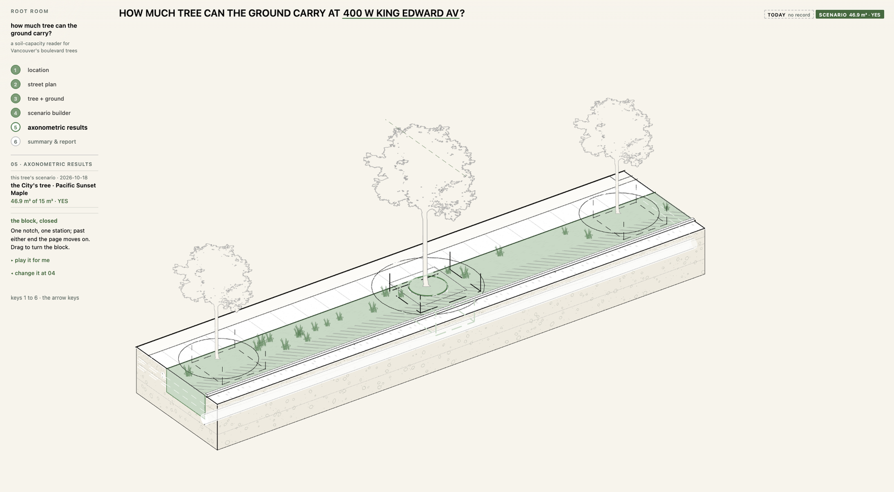
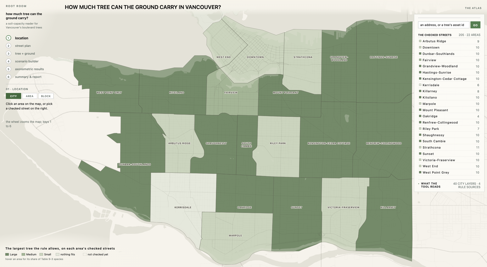
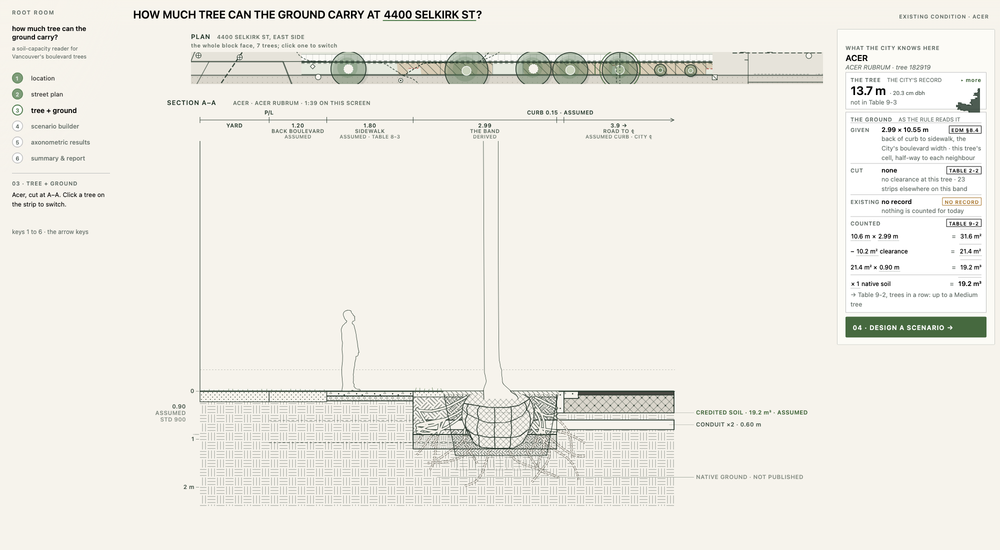
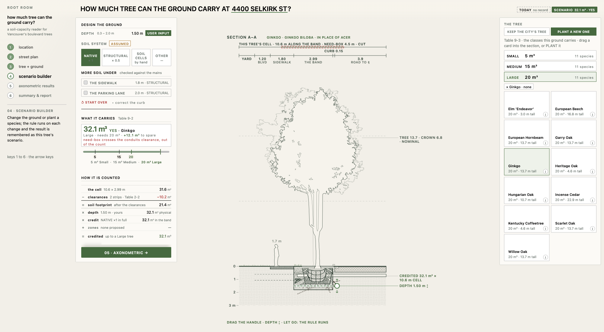
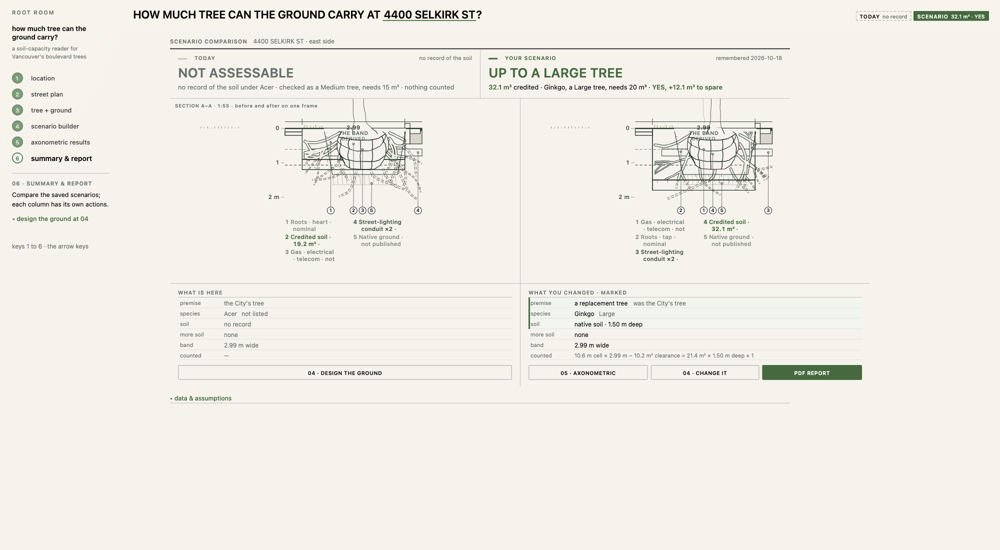

<h1 align="center">Root Room</h1>
<p align="center"><b>How much tree can the ground carry?</b><br>ARCH 540 · Assignment 1 · Making Design Knowledge Interactive</p>
<p align="center"><a href="https://kaiyankay.github.io/root-room/"><b>Open the live demo →</b></a><br><sub>a desktop browser, 1500 × 800 or larger · any public street tree in Vancouver</sub></p>

<p align="center"></p>


## Purpose

Vancouver's street tree standards say how much soil a tree of each size needs. The number alone does not show what that volume means on a real street, where a tree shares the ground with sidewalks, roads, utilities, pavement and neighbouring trees.

Root Room turns the soil volume requirement into a spatial design question. It takes a real Vancouver street condition and tests how changes to soil depth, soil system and connected soil space change the amount of credited soil and the size of tree the site can support.

The goal is not simply to calculate soil volume. It is to understand how the ground itself can be designed to make more room for trees.

## What it does

**street condition → ground design → credited soil volume → tree size**

Root Room starts from a real public street tree, reads the City's data about the tree and the street around it, lets you design the ground under it (soil depth, soil system, more soil under the sidewalk or the parking lane, the tree kept or a new species planted), counts the physical and the credited soil volume, and sets the result against the City's requirement. The answer is drawn as well as counted: a street plan, a section through the tree, an exploded axonometric of the planting, a before-and-after comparison, a one-page report and, from the same remembered scenario, Rhino geometry.

## Run the demo

**Online.** [kaiyankay.github.io/root-room](https://kaiyankay.github.io/root-room/) runs the whole tool for any City tree, with nothing to install. The page is static; the rule engine runs inside your browser (Python compiled to WebAssembly with [Pyodide](https://pyodide.org)), the same code as the local server, so the numbers are the engine's, not an approximation. The pilot street, the 400 block of West King Edward Avenue, is carried by the page and opens at once. Any other street is fetched when you first open it: the engine in your browser reads the City's layers around the tree from the City's Open Data portal and VanMap services (about a minute), then runs; the street is kept for the rest of the visit, and so is the scenario you make on it.

**On your own machine,** for any street in the City. Python 3.10+ and one package. The page loads three.js and jsPDF from a CDN, so the browser needs internet access.

```bash
pip install jsonschema
python3 scripts/serve_web.py --port 8767
```

Open **http://127.0.0.1:8767/** in a desktop browser (composed for 1500 × 800 and up; best at 1500 × 955). The pilot street, the 400 block of West King Edward Avenue, is ready to use: this repository carries its City data. Any other street works too; its City data is fetched on first use and kept. The engine and the exporter run inside the server: the first run after a start takes a few seconds, after that a ground change answers in well under a second.

The online version is built by `scripts/build_static.py` and published by GitHub Actions (`.github/workflows/pages.yml`) at every push to `main`. To host the full server instead, the repository carries a `Dockerfile` (any container host) and a `render.yaml` (Render).

## The six stages

One question runs through the page, *how much tree can the ground carry at …?*, and one continuous scroll answers it in six stages on one drawing. The rail's steps, the keys 1–6 and the arrow keys jump between them; every forward button names the stage it goes to. Every run shows itself: a bar along the top of the sheet fills over the time the last run took, and the stage tag counts the seconds.

<p align="center"></p>

**1 · location.** The city as an atlas. Scroll zooms through three levels (CITY · AREA · BLOCK); a click chooses the subject at each level: a local area, one of its checked streets, or, at the block level, any public tree as a dot. The rail lists what the tool reads (the City layers and the rule sources) and the checked streets of the focused area, 205 block faces in the 22 local areas. Any address or tree id typed into the title runs the engine for a new street.

**2 · street plan.** The whole block face at one scale: the property line, the sidewalk, the band, the curb, the road, every tree with its share of the band in m³, the mains' clearance strips hatched across the band. Click a tree and its card opens; the A–A mark drags along the street and picks the tree it crosses.

<p align="center"></p>

**3 · tree + ground.** Before anything is changed, what is known about this site. SECTION A–A runs from the yard to the centreline with the ground drawn in the City's standard-detail hatches, the tree's nursery ball and its roots in the credited soil, the mains in their trenches, and every layer named on a leader. The column reads THE TREE (the City's record) and THE GROUND as the rule reads it: GIVEN, CUT, EXISTING, COUNTED, each value with its tag; a tag opens the page of the manual it comes from. A curb measured on site can be entered with its evidence and replaces the assumed curb.

<p align="center"></p>

**4 · scenario builder.** Design the ground and see how much tree it can carry. Left, THE GROUND: the soil depth (a slider, or the handle on the section), the soil system (native, structural, soil cells), more soil under the sidewalk or the parking lane, checked against the mains, and START OVER. Centre: SECTION A–A with the whole tree, the depth handle on the band and the credited soil named on the drawing. Right, THE TREE: keep the City's tree or plant a new one, the Table 9-2 classes the ground carries (Small · Medium · Large, FITS or NO ROOM) and the Table 9-3 species of each class as cards, dragged into the section or planted with a click. WHAT IT CARRIES answers first: the figure and the class it reaches, a placed species' verdict with its requirement and the gap, the Table 9-2 ruler, then HOW IT IS COUNTED, the ledger from the cell to the credited soil. Every finished run is remembered as this tree's scenario, one per tree; the title keeps TODAY and SCENARIO side by side at stages 4, 5 and 6.

**5 · axonometric results.** The scenario built: the block opens station by station — the surface, the planter with the credited soil, the tree coming down into its pit with the roots growing out, the mains at their recorded depth, the native ground drawn as a soil section and captioned as a convention. One wheel notch is one station; drag to turn the block; a ladder of numbers opens any station.

<p align="center"></p>

**6 · summary & report.** The answer as one row: TODAY | YOUR SCENARIO, each with the class the ground carries (NOT ASSESSABLE · UP TO A LARGE TREE · ONLY A SMALL TREE · MANUAL REVIEW), the volume credited, the species, its requirement and the verdict with the gap. Under it the two grounds drawn as 3's ground detail on one frame at one scale, before and after, each with its numbered key; then the same six rows for both (premise · species · soil · more soil · band · counted), the scenario's differences from today marked; 05 · AXONOMETRIC, 04 · CHANGE IT, and PDF REPORT, one letter page in landscape with the section, the rows and the sourced count.

## The rule behind it

Root Room operates one small part of the City of Vancouver Engineering Design Manual (2026): **Section 9.3 Urban Forest** and its **Table 9-2 Soil Volumes for Street Trees**, which ties a required soil volume to a tree size class. Around that table the tool reads what the table needs to be applied on a real street:

| source | what it decides | where it is on the page |
|---|---|---|
| EDM Table 9-2 | the volume a Small, Medium or Large tree needs (trees in a row) | 04 WHAT IT CARRIES (the ruler), 06's answer row |
| EDM Table 9-3 | the City's street tree list by size class; a species never has a class inferred | 04 THE TREE, the species cards |
| EDM Tables 8-3 and 8-4 | the sidewalk and back-boulevard widths of the land-use row, hence the band's width between the back of curb and the sidewalk | 03 THE GROUND · GIVEN, the plan's dimensions |
| EDM Table 2-2 | the clearance each main takes from the band; the band is interrupted there | the plan's hatched strips, 03 THE GROUND · CUT, the section's red NOT CREDITED edge |
| the crediting rule | native soil counts in full, structural soil at one half, soil cells for new trees only | 04 SOIL SYSTEM, HOW IT IS COUNTED |
| the connected zones | soil proposed under the sidewalk or the parking lane counts when it connects to the tree's cell past the mains | 04 MORE SOIL UNDER · the zone's status |
| the premise | an existing tree's Table 9-2 value is a benchmark; a replacement tree is sized by what the ground gives | 04 THE TREE · KEEP THE CITY'S TREE / PLANT A NEW ONE |

The tool does not translate the whole manual. It asks one question, *how does a soil volume requirement become a spatial design decision on a real street?*, and turns the answer into an operation that can be repeated for any site and any set of inputs. The rules as the engine reads them are in `sources/06_rules.json`, each cited to the page of the manual it comes from; the manual itself is not included, the City publishes it. Five of its cited pages (Tables 2-2, 8-3, 8-4, 9-2 and 9-3) are rendered under `web/assets/docs/` so a tag on the page can show the table it reads from.

## How the calculation works

For the chosen tree the engine measures the block face from City geometry: the street centreline, the property line from the block outlines and parcels, the trees on the face and their spacing, the right-of-way. The band between the back of curb and the sidewalk is apportioned to the trees as cells, and the mains' clearances are cut out of it. A scenario adds the proposed depth, soil system and zones; the engine returns the physical volume (footprint × depth), the credited volume (physical × the soil system's credit, plus connected zones), and the Table 9-2 classes that volume carries. The page draws the same numbers: the band and the cell in plan, the credited soil and the roots in section, the planter in the axonometric. The purpose is not only to say how many cubic metres there are, but to show which spatial change produced the number.

## What the tool knows

Not everything on the page has the same source, and the page keeps them apart with four tags:

- **CITY** · read from a City record: the tree (species, height, diameter, planting year), its position, the street geometry, the mains in plan, the recorded depths where VanMap publishes them.
- **DERIVED** · calculated from City geometry: the band width, a tree's cell and spacing, the share of the band it is given, the clearances that cut it.
- **ASSUMED** · introduced by the tool or the designer and shown as such: the curb line where the City publishes none (from the catch basins and the trunks), the land-use row, and at 04 every proposed value.
- **NO RECORD** · not available in the source material. The City has no record of the existing soil under a street tree, so the existing soil volume stays NO RECORD; nothing is counted for today, and the page says so. A proposed depth can be introduced in a scenario, but it is an assumption, never an existing condition.

Below grade, the ground is drawn in the hatches of the City's standard details and the roots as a landscape section draws them, captioned as a drawing convention, not data. The ball is the nursery ball of the tree's caliper and never grows; the roots take the soil the rule credits, however deep it is dug. Every drawn depth carries its grade (City record · derived · nominal · not published).

## Web and Rhino

The web tool is for interaction: move through the site, pick a tree, change the ground, run the rule, see the spatial answer at once. The remembered scenario is one file, `data/processed/scene_<site>_A.json`, and Rhino reads that file alone: a builder script (run through the RhinoAI MCP in Rhino 8, kept with the working files rather than in this repository) rebuilds the street, the band's cells at their credited volumes, the zones, the mains and the tree as geometry, and its cell volumes match the engine's. The browser does not display the Rhino output; the browser is the interactive spatial preview and Rhino the second representation of the same scenario, from the same logic.

**web → remembered scenario → Rhino geometry**

## What Root Room does not decide

It does not decide whether an existing tree should stay or be removed; the premise is yours, and the tool shows what each premise implies. It does not predict tree health or survival. It does not claim to know underground conditions that the source data does not hold. It never treats a proposed scenario as an existing condition. It is not a compliance checker for the Engineering Design Manual; it works one relationship between street space, soil volume and tree size, to support spatial testing and design decisions around it.

## Command line

The same engine runs for any City tree without the page:

```bash
python3 scripts/run_site.py --address "2819 W 11th Av"        # lists the trees at that address
python3 scripts/run_site.py --asset-id 10880 --site-type boulevard \
    --curb 4.2 --depth 0.9 --target Medium --soil native_soil --land-use residential_detached
```

The first run for a new area fetches the City Open Data context, the underground layers and the VanMap depth layers for a 500 m window and reuses them afterwards. Output: `data/processed/block_face_V-<asset_id>.json`, every number with its provenance. An existing soil typed with evidence (`--existing-width --existing-depth --existing-soil --existing-provenance CONFIRMED_SITE_DATA --existing-evidence …`) is counted; typed without evidence it is marked USER_INPUT.

## Repository

| | |
|---|---|
| `web/` | the page: `one.html`, `js/one.js` (the six stages, the drawings, the panels), `js/scene.js` (the three.js scene), `js/static-api.js` + `js/engine-worker.js` (the engine in the browser, for the online build), `css/`, `assets/` (the line-art trees, the manual's cited pages), `models/` |
| `src/` | the engine: `sites.py` (any tree → a SITE record), `block_face.py` (measure the face, apportion the band, evaluate), `rule_engine.py`, `calculations.py`, `schema_validation.py`; the server's API `web_api.py`, `scene_api.py` (runs the engine and the exporter in-process, remembers the scenario), `window_index.py` (which City window files a site needs) |
| `scripts/` | `serve_web.py` (the server), `run_site.py` (any tree), `run_block_face.py`, `export_scene.py` (the scene file the page draws), `fetch_context.py`, `fetch_vanmap.py`, `fetch_ground_layers.py`, `build_static.py` (the online build) |
| `sources/` | the rules (`06_rules.json`), the record schema, the drawing standard, the Table 9-3 transcription, the Street Tree Guidelines and root-atlas extracts |
| `data/` | `raw/` the pilot window's City files as served (Open Data, `vanmap/`), `processed/` the pilot's engine and scene files and the atlas summary, `species/` the species library |
| `docs/` | the captures in this README |

## Data

| what | from | in the repository |
|---|---|---|
| every public tree, the streets, the local areas | City of Vancouver Open Data | yes (`data/raw/`) |
| the pilot street's underground layers (mains, conduits, catch basins, poles) and VanMap depths | City Open Data · VanMap | yes (`*__king_edward_window.geojson`) |
| the same for any other street | fetched on first use by `scripts/fetch_context.py` and `fetch_vanmap.py`, or by the engine in the browser online | no: fetched, then kept, ignored by git |
| the 205 checked block faces (the atlas colours) | a batch run of this engine | summary only (`citywide_faces.json`) |
| the Table 9-3 species library | EDM 2026 + City tree counts | yes (`data/species/`) |

City data is used under the City of Vancouver Open Government Licence.

## Status and limits

- Online and locally, any City tree runs from the City's data on first visit (about a minute online, where the browser fetches the street's layers; about two minutes locally, with the fetch). 205 checked block faces in the 22 local areas open at once. A street fetched online is kept for the visit, not stored.
- One scenario per tree. Every finished run at stage 4 is remembered as that tree's scenario; START OVER drops it. Online it lasts for the visit; locally it is a file.
- The existing soil has no City record anywhere; the page shows NO RECORD and counts nothing for today. A measured existing soil can be typed with evidence on the command line, not yet on the page.
- A tree whose trunk stands inside a main's clearance, or a cell the rule cannot read, is a MANUAL REVIEW: the page says why on every stage and offers to correct the curb where that is the cause.
- A kept City tree is drawn with a nursery ball like a new one; a mature tree's root flare and plate are a drawing still to be made.
- Species are drawn as the library's line-art; Rhino species models are parked.
- Composed for a desktop window of 1500 × 800 and up. `?t=1.5 / 2.5 / 3.5 / 4.85 / 5.5` opens the page at a stage.

## Sources

City of Vancouver Engineering Design Manual (2026), §9.3 Urban Forest, §8.4 boulevards, Table 2-2 clearances; Protection of Trees By-law 9958; Street Tree Guidelines (2011); the City's standard detail drawings; City of Vancouver Open Data and VanMap layers; the Vancouver Park Board Park Development Standards and the Wageningen root atlas as the references for how the sections and the roots are drawn.
